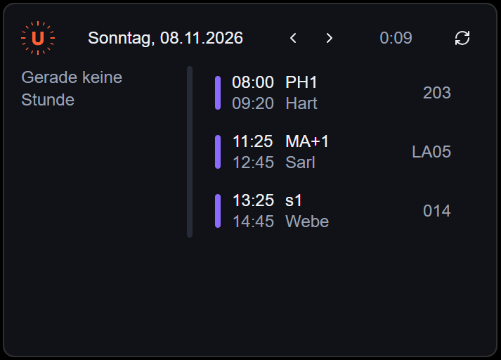

# WebUntis Widget
A Windows 11 desktop widget for students and teachers that use the Webuntis time table service (popular in Germany and Austria). The Webuntis Widgets give students and teachers an overview of their classes and timetables.

<p align="center">
  
  <br>
  <em>The widget on my desktop, showing one day's timetable</em>
</p>

## Installation

### Option 1
Since it is a desktop app, there is no live link. Download the installer from the GitHub Releases page. (Will be setup)

Then create the login file, see [Login setup](#login-setup) below.

### Option 2
Clone the Github repository. You need Node, Rust and the [Tauri prerequisites for Windows](https://v2.tauri.app/start/prerequisites/).

```
cd windows-webuntis-widget
npm install
npm run tauri dev
```

Create the login file first, see below.

## Login setup
The widget reads your school login from a `.env` file:

```
SERVER_SCHOOL_SERVER=school.webuntis.com
SERVER_SCHOOL_NAME=school-name
SERVER_USERNAME=username
SERVER_PASSWORD=password
```

- **Installed app:** press Win+R, type `%APPDATA%` and press Enter. Create a folder called `windows-webuntis-widget` there and put the `.env` file inside it.
- **Running from the code:** put the `.env` file in `windows-webuntis-widget/src-tauri/`.


## Features
- Shows today's lessons, with the arrows at the top to move through days.
- Highlights the current lesson, and the next lesson of the same subject.
- A progress bar the shows how far through the school day you are.
- A small frameless window that works as a desktop widget.

## How it works
The Rust backend logs into WebUntis with the untis-rs library and it turns each lesson into a small struct, so the Reat side only shows the data and never touches the raw API format with the sensitive data. I used Tauri here, because it is much more lightweight in comparision with other frameworks. One problem was that WebUntis also returns all-day events (00:00-23:59) that aren't real lessons, so those are filtered out before the list is shows. The login is read at runtime from a .env file in %APPDATA%.

## Credits
Special thanks to Claude Code 😁 for helping me refactor my code, helping me improve the frontend and setting up the Github Actions workflow.
